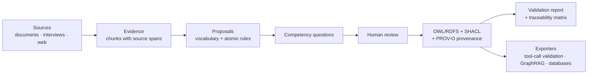

# evidonto

**Evidence-backed domain ontologies, built from what an organization actually documents and says.**

evidonto researches a company or domain from its documents, interviews and public web pages, and uses open-weight LLMs to propose a domain ontology (OWL/RDFS) and its business rules (SHACL). Every class, property and rule it proposes points back to the source excerpt that justifies it, and every rule ships with a test.

> **Status: concept.** There is no code yet. This repository holds the plan and the roadmap. Ideas and discussion are welcome in the issues.

## Why

LLMs can turn a pile of documents into a graph quickly, but the result is hard to trust: nobody can tell which parts came from the sources and which were invented. An ontology that will guard an AI agent, structure a GraphRAG index or define a database schema needs to be **auditable**.

evidonto treats ontology building as a research process with a paper trail:

```
source excerpt  →  atomic rule  →  ontology element / SHACL shape  →  test case
```

That chain, the **traceability matrix**, is the main output, together with the ontology itself.

## How it works



1. **Collect sources.** Policies, manuals, contracts, interview transcripts, public web pages.
2. **Extract evidence.** Split sources into chunks that keep their origin (file, page, timestamp, URL).
3. **Propose.** An LLM proposes vocabulary (nouns become classes, relations become properties, states become individuals) and atomic rules (each one fails in exactly one way), always citing the evidence it used.
4. **Ask competency questions.** Questions the ontology must answer, turned into executable SPARQL tests.
5. **Review.** A human accepts, edits or rejects each proposal. Nothing goes in unreviewed.
6. **Generate.** Turtle files for the ontology (OWL/RDFS), the rules (SHACL) and the provenance (PROV-O).
7. **Validate.** Each rule is checked against one case that passes and one that violates it.

## Principles

- **Open source only.** Open-source libraries and open-weight models. The LLM layer talks to any OpenAI-compatible endpoint, with [Ollama](https://ollama.com) as the default; [vLLM](https://github.com/vllm-project/vllm) and [llama.cpp](https://github.com/ggml-org/llama.cpp) work the same way. No proprietary API is required.
- **Evidence first.** No element without a cited source excerpt.
- **Human in the loop.** The LLM proposes; a person decides. An unreviewed ontology is a guess.
- **OWL describes, SHACL validates.** Validation runs closed-world with inference off, so a missing entity is reported as missing instead of being inferred into existence.
- **Local first.** Interviews and internal documents contain personal and confidential data. Everything runs on your machine by default.

## Use cases

- **Tool-call validation for LLM agents.** Check whether a call is consistent with the domain state and rules before it runs (does this reservation exist, does it belong to this customer, does the policy allow cancelling it now?), and return the reason to the agent when it is blocked.
- **GraphRAG.** A reviewed schema for building and querying knowledge graphs, instead of one improvised from the text.
- **Databases.** Derive constraints, schemas and JSON-LD contexts from the same rules.
- **Documentation and onboarding.** A navigable map of a domain, where every statement links to its source.

## Planned stack

| Need | Tool |
|---|---|
| Language | Python |
| RDF, OWL, SPARQL | [rdflib](https://github.com/RDFLib/rdflib) |
| SHACL validation | [pySHACL](https://github.com/RDFLib/pySHACL) |
| Document parsing (PDF, DOCX, HTML) | [Docling](https://github.com/docling-project/docling) |
| Interview transcription | [Whisper](https://github.com/openai/whisper) / [whisper.cpp](https://github.com/ggml-org/whisper.cpp), run locally |
| Web extraction | [Trafilatura](https://github.com/adbar/trafilatura), [Playwright](https://github.com/microsoft/playwright-python) |
| LLM runtime | Ollama, vLLM or llama.cpp (OpenAI-compatible API) |
| Manual editing | Output opens in [Protégé](https://protege.stanford.edu) |

## Roadmap

### v0.1: Documents → ontology with evidence
- [ ] CLI skeleton (`evidonto init`, `evidonto ingest`, `evidonto propose`, `evidonto build`)
- [ ] Ingest PDF, DOCX, Markdown and HTML with Docling, keeping source spans
- [ ] Provider-agnostic LLM client (OpenAI-compatible endpoint, Ollama by default) with structured output
- [ ] Propose vocabulary and atomic rules, each citing its evidence
- [ ] Generate Turtle files: ontology (OWL/RDFS), rules (SHACL), provenance (PROV-O)

### v0.2: Competency questions and evaluation
- [ ] Generate competency questions and turn them into SPARQL tests
- [ ] Traceability matrix: source → rule → shape → test (CSV and HTML)
- [ ] A passing and a violating test case for every rule
- [ ] First benchmark: the airline domain policy from [τ²-bench](https://arxiv.org/abs/2506.07982), compared with a hand-built reference ontology
- [ ] Quality report: competency-question coverage, rules without evidence, SHACL validity

### v0.3: Human review
- [ ] Review flow (CLI first, then a small local web UI) to accept, edit or reject each proposal
- [ ] Versioned ontology with readable diffs between runs
- [ ] Record who approved each element and when

### v0.4: Interviews
- [ ] Generate an interview guide from the competency questions the sources cannot answer yet
- [ ] Local transcription with Whisper, with speaker labels
- [ ] PII redaction before any text reaches the LLM
- [ ] Transcripts become evidence like any other document (cited by timestamp)

### v0.5: Exporters
- [ ] Tool-call validator: tool registry + JSON Schema + SHACL, returning the reason when a call is blocked
- [ ] GraphRAG schema export
- [ ] Database export: SQL constraints and JSON-LD `@context`

### v0.6: Web research
- [ ] Opt-in collection of public company pages, respecting `robots.txt` and terms of use
- [ ] Reliability tag per source (official policy, marketing page, third-party)

### Later
- Incremental updates when sources change, flagging rules whose evidence was removed
- Discover missing rules from agent failure logs
- Alignment with standard vocabularies (schema.org and domain standards)
- Multilingual sources

## Non-goals

- **Not a fully automatic ontologist.** Human review is part of the process, not an optional step.
- **Not a replacement for backend authorization.** The validator rejects bad calls early and explains why; the system of record still enforces its own rules.
- **Not intent checking.** A call that is valid in the domain but not what the user wanted is out of scope.

## Related work

Projects worth knowing, and how evidonto differs:

- [OntoGPT](https://github.com/monarch-initiative/ontogpt): LLM-based extraction of information into existing ontology schemas (SPIRES). evidonto builds the schema and its rules.
- [OntoChat](https://github.com/King-s-Knowledge-Graph-Lab/OntoChat): LLM-supported collaborative ontology engineering. evidonto focuses on source evidence, SHACL rules and tests.
- [Neo4j LLM Graph Builder](https://github.com/neo4j-labs/llm-graph-builder) and [Microsoft GraphRAG](https://github.com/microsoft/graphrag): build knowledge graphs from text. evidonto produces the reviewed, validated schema such graphs can follow.

## Background

The idea comes from research on validating LLM agent tool calls against a domain ontology with SHACL. In that work the ontology and the rules were modeled by hand from a written policy, one rule at a time. That step is slow, and evidonto is the plan to make it faster without giving up the paper trail.

## Contributing

There is no code yet, so the most useful contributions are ideas: open an issue to discuss a use case, a source type, or a part of the roadmap.

## License

[Apache License 2.0](LICENSE)
